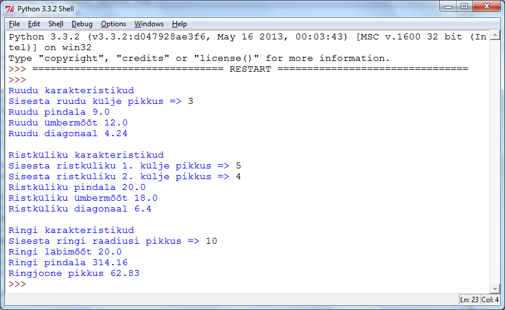
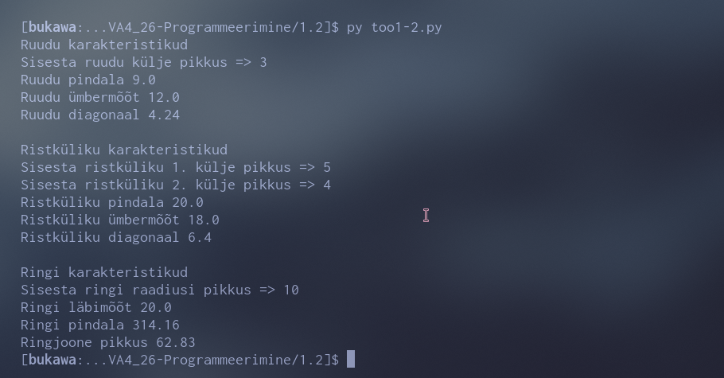
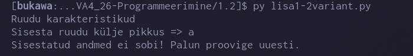

## Ülesanne "Töö 1.2 Iseseisev töö | Vigade otsing -1" kirjeldus oli:
- `Otsi ja paranda programmis vead.`
- `Lisa kommentaar, kus kirjelda, mis parandatud oli.`

> `Programmi tulemus peab olema nii:`
- Original:
[]
- Minu variant:
[]

## Ülesanne difficulty:
** EASY / NOOB MODE **

## Seal oli ka lisa BOONUS ülesanne:
> - Muuda programmi nii, et see kontrolliks muutujatesse sisestatud andmete tüüpi, 
blokeerides selle seni, kuni sisestame vajalikud andmed.
> P.S Vaata fail nimega "lisa1-2variant.py"
[]
